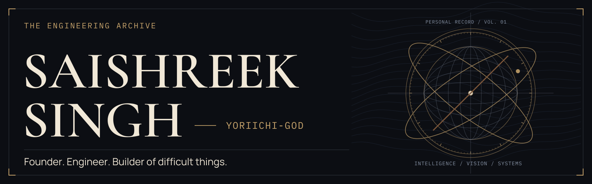
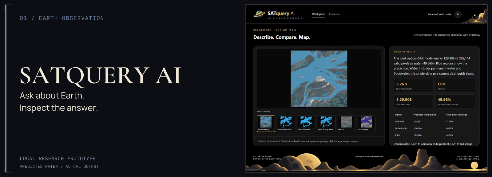
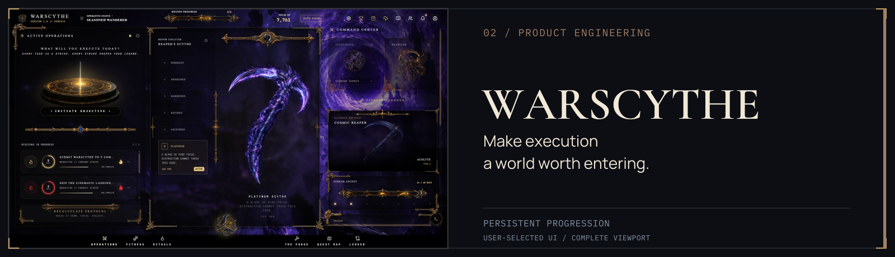
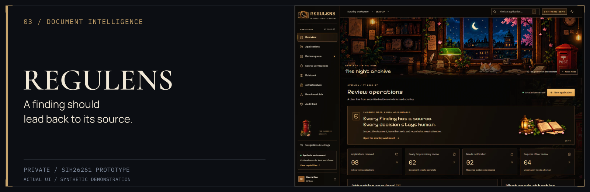
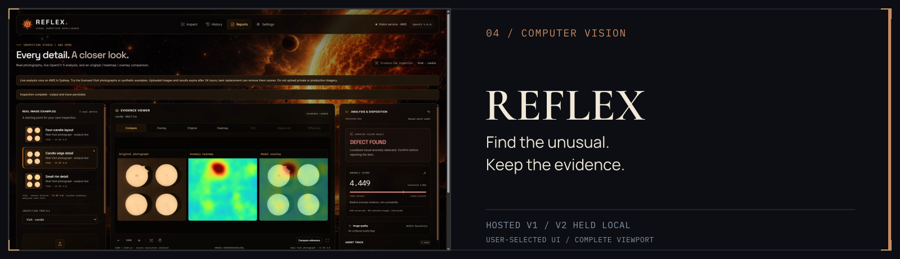
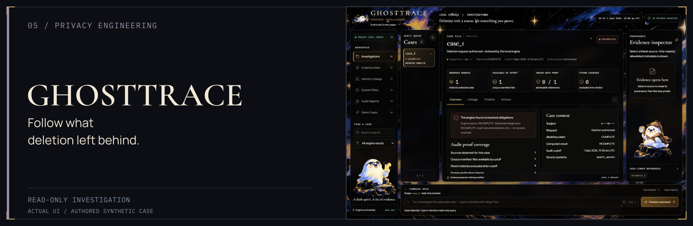
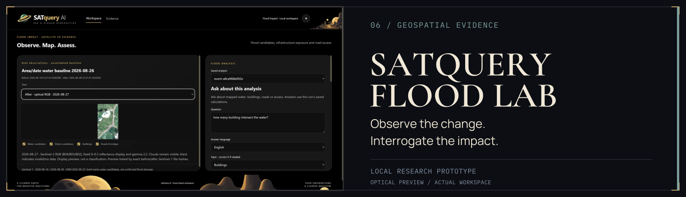
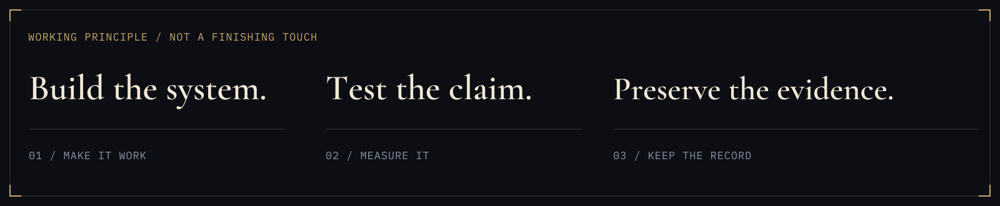

<picture>
  <source media="(max-width: 600px)" srcset="assets/hero-mobile.svg">
  
</picture>

I’m **Saishreek Singh**, a founder and engineer building across artificial intelligence, applied machine learning, computer vision, Earth observation, and full-stack products. I’m interested in the part after a system produces an answer: can someone inspect it, test it, and understand its limits? This archive brings together research prototypes and product work, with their evaluation records, source trails, and unfinished questions intact.

**[Repositories](https://github.com/Yoriichi-GOD?tab=repositories)** · **[REFLEX live v1](https://re-c0a0c131729f4898bb80d160feb0ccc7.ecs.ap-southeast-2.on.aws/)** · **[Recorded demonstration](https://youtu.be/WvnKxOTxkvw)** · **[Evidence](#verified-engineering-evidence)**

## Selected engineering work

<picture>
  <source media="(max-width: 600px)" srcset="assets/projects/satquery-mobile.svg">
  
</picture>

**[SATQUERY AI](https://github.com/Yoriichi-GOD/SATquery-AI)** — Inspectable satellite analysis: optical/SAR water pathways, multitemporal change, and a dedicated change-question specialist. Separate modality outputs and published controls make the result open to scrutiny. Local research prototype; model assets require provisioning.

[Open full UI](https://raw.githubusercontent.com/Yoriichi-GOD/SATquery-AI/f5a5a5fb2af8466a304911e462ecfae305f09b6b/docs/images/workspace-water-dark.png) · [Reviewer walkthrough](https://github.com/Yoriichi-GOD/SATquery-AI/blob/main/docs/REVIEWER_GUIDE.md) · [Recorded evaluation](https://github.com/Yoriichi-GOD/SATquery-AI/blob/main/docs/CDVQA_FINAL_REPORT.md)

Water specimen: Sen1Floods11 / Cloud to Street; modified Copernicus Sentinel data. Predicted coverage is not accuracy. [Visual sources](docs/CONTENT_PROVENANCE.md#visual-sources).

<picture>
  <source media="(max-width: 600px)" srcset="assets/projects/warscythe-mobile.svg">
  
</picture>

**[WARSCYTHE](https://github.com/Yoriichi-GOD/warscythe)** — A fantasy-inspired execution engine where tasks, rituals, and fitness feed persistent progression. React, Supabase, and Capacitor Android packaging; domain-specific PostgreSQL reconciliation and idempotent progression events sit beneath the world-building.

[Open full UI](assets/projects/warscythe-ui.webp) · [Source and architecture](https://github.com/Yoriichi-GOD/warscythe#engineering--architecture) · [Sync implementation](https://github.com/Yoriichi-GOD/warscythe/blob/main/supabase/migrations/20260719_warscythe_sync_v2.sql)

<picture>
  <source media="(max-width: 600px)" srcset="assets/projects/regulens-mobile.svg">
  
</picture>

**REGULENS · Private prototype · SIH26261** — Institutional-document scrutiny through extraction, evidence-linked findings, and reasoned human review. Findings link back to supporting documents. Simulation rules support preliminary review; final authority stays human. Source and reviewer materials require authorized access.

[Open full UI](assets/projects/regulens-ui.webp) · Actual dashboard with fictional demo records. Screenshot reuse authorized; source repository remains private.

<picture>
  <source media="(max-width: 600px)" srcset="assets/projects/reflex-mobile.svg">
  
</picture>

**[REFLEX](https://github.com/Yoriichi-GOD/REFLEX)** — Visual anomaly inspection with normal references, heatmaps, and retained human review. Adaptive experiments preserve missed defects and false alerts alongside improvements. Hosted v1 is a demonstration; v2 remains held locally. Neither is a factory safety system.

[Open full UI](assets/projects/reflex-ui.webp) · [Reviewer tour](https://github.com/Yoriichi-GOD/REFLEX/blob/main/docs/REVIEWER_GUIDE.md) · [AWS v1 demo](https://re-c0a0c131729f4898bb80d160feb0ccc7.ecs.ap-southeast-2.on.aws/) · [Study and limits](https://github.com/Yoriichi-GOD/REFLEX/tree/main/benchmarks/anomaly_v2)

Photograph: VisA / Amazon Science, [CC BY 4.0](https://creativecommons.org/licenses/by/4.0/). Heatmap and overlay: REFLEX. Complete supplied viewport, scaled; curated example, not an accuracy estimate.

<picture>
  <source media="(max-width: 600px)" srcset="assets/projects/ghosttrace-mobile.svg">
  
</picture>

**[GHOSTTRACE](https://github.com/Yoriichi-GOD/GhostTrace)** — A read-only deletion audit connecting identity history, cutoff-aware evidence, and policy-driven findings. One Python auditor powers CLI and dashboard, with masked sources and reviewable recommendations. Local prototype; it never executes deletions or certifies compliance.

[Open full UI](https://raw.githubusercontent.com/Yoriichi-GOD/GhostTrace/c827b06d9310c872e1334ed34a99dfb529f97e57/docs/media/investigation-overview.png) · [Follow an investigation](https://github.com/Yoriichi-GOD/GhostTrace/blob/main/docs/REVIEWER_GUIDE.md) · [Evaluation and limitations](https://github.com/Yoriichi-GOD/GhostTrace/blob/main/code/evaluation/evaluation_report.md)

<picture>
  <source media="(max-width: 600px)" srcset="assets/projects/flood-lab-mobile.svg">
  
</picture>

**[SATQUERY FLOOD LAB](https://github.com/Yoriichi-GOD/SatQuery---Flood-Lab)** — Water-change candidates, historical infrastructure exposure, and geospatial exports. SAR comparisons and map intersections travel with provenance and frozen artifact hashes. Local research workspace; flood accuracy, damage, and real settlement isolation remain unvalidated.

[Open full UI](assets/projects/flood-lab-ui.webp) · [Saved-case walkthrough](https://github.com/Yoriichi-GOD/SatQuery---Flood-Lab/blob/main/docs/guides/REVIEWER_WALKTHROUGH.md) · [Evidence and open questions](https://github.com/Yoriichi-GOD/SatQuery---Flood-Lab/blob/main/docs/guides/EVIDENCE.md)

Contains modified Copernicus Sentinel data 2026; [© OpenStreetMap contributors](https://www.openstreetmap.org/copyright). The displayed optical preview is an observation, not a flood classification or confirmed damage. [Visual sources and attribution](docs/CONTENT_PROVENANCE.md#visual-sources).

## Engineering disciplines

 **Intelligent systems** — applied ML, document intelligence, multimodal inputs.

 **Computer vision** — anomaly inspection, classification, visual evidence.

 **Geospatial intelligence** — remote sensing, optical/SAR analysis, change detection.

 **Product engineering** — full-stack interfaces, persistent state, Android packaging.

 **Verification & evaluation** — benchmarks, provenance, regression checks, human review.

Selected tools used across the repositories: Python · PyTorch · OpenCV · Rasterio · Shapely · React · TypeScript · Node.js · FastAPI · PostgreSQL / Supabase · SQLite · Capacitor

## A working principle

<picture>
  <source media="(max-width: 600px)" srcset="assets/identity/method-mobile.svg">
  
</picture>

My work increasingly focuses on traceability, measurable performance, reproducible checks, and clear limitations. A convincing demonstration starts an investigation; it does not finish one. These projects occupy different stages of maturity. The record should make those differences visible.

## Further in the archive

**[PEEKOLITIX](https://github.com/Yoriichi-GOD/peekolitix)** — India-focused political information application. AI-assisted reports, full-stack product flows, and Android packaging. Independent project; no government affiliation.

**[LIGHTHOUSE](https://github.com/Yoriichi-GOD/lighthouse)** — A TinyFish source-and-research workspace. Matching source passages in Normal mode; a separate cited report in Research mode. Server-side keys and local history; controlled deployment configuration.

## Verified engineering evidence

Recorded evaluations, with their populations kept separate. These are **project-reported measurements**, not new runs for this profile.

**[SATQUERY / 28 SEP 2026](https://github.com/Yoriichi-GOD/SATquery-AI/blob/main/docs/CDVQA_FINAL_REPORT.md)** — **69.90%** exact answer accuracy on CDVQA Test-1: **39,686 questions / 968 pairs**. Question-only control: **68.06%**. Experimental specialist; prior pair inspection and exclusion analysis disclosed. Not overall product accuracy.

**[REFLEX / 25 OCT 2026 AUDIT](https://github.com/Yoriichi-GOD/REFLEX/blob/main/benchmarks/intelligence_20261025/README.md)** — **860 distinct VisA photographs**: **350 reused replay / 255 development / 255 final**. [Final macro image AUROC](https://github.com/Yoriichi-GOD/REFLEX/blob/main/benchmarks/anomaly_v2/README.md): **0.8520 → 0.8410**. v2 stays local. The dated audit indexes earlier measurements; it is not a new run.

**[GHOSTTRACE / 25 OCT 2026](https://github.com/Yoriichi-GOD/GhostTrace/blob/main/code/evaluation/evaluation_report.md)** — **29/32** public development statuses matched; only **8/32** exact ordered step sequences matched. Hidden-case accuracy is unknown. Status agreement does not establish evidence completeness or real-world compliance.

REGULENS’s evaluation is private. Flood Lab’s independent accuracy remains open. [Claim sources, visual credits, and interpretation limits](docs/CONTENT_PROVENANCE.md).

## Current interests & contact

Inspectable AI, multimodal Earth observation, document intelligence, visual inspection, and products whose state and claims can survive scrutiny.

**[Explore the repositories](https://github.com/Yoriichi-GOD?tab=repositories)** · **[GitHub / Yoriichi-GOD](https://github.com/Yoriichi-GOD)** · **[Watch REFLEX](https://youtu.be/WvnKxOTxkvw)**

For project discussion, use the relevant public repository.

**Leave a system someone else can inspect.**
